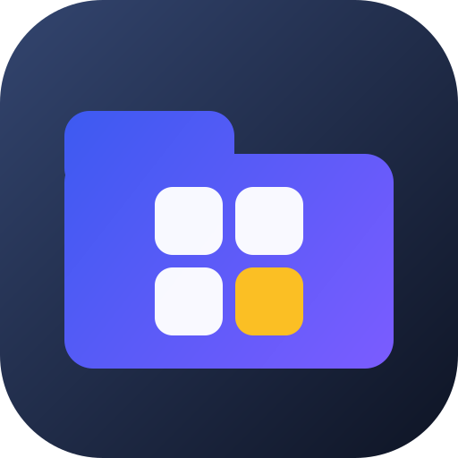
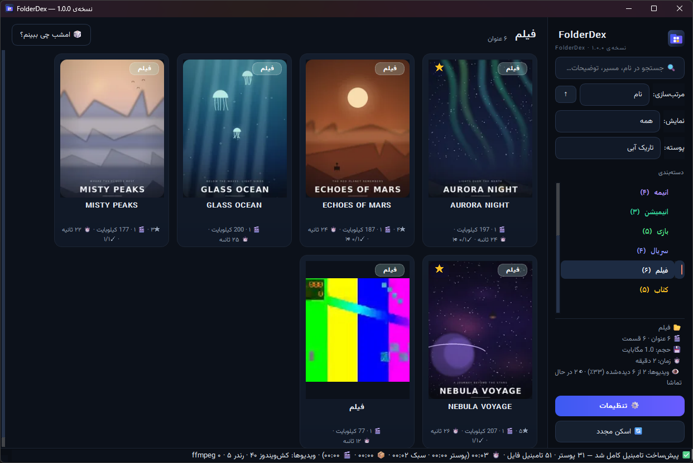
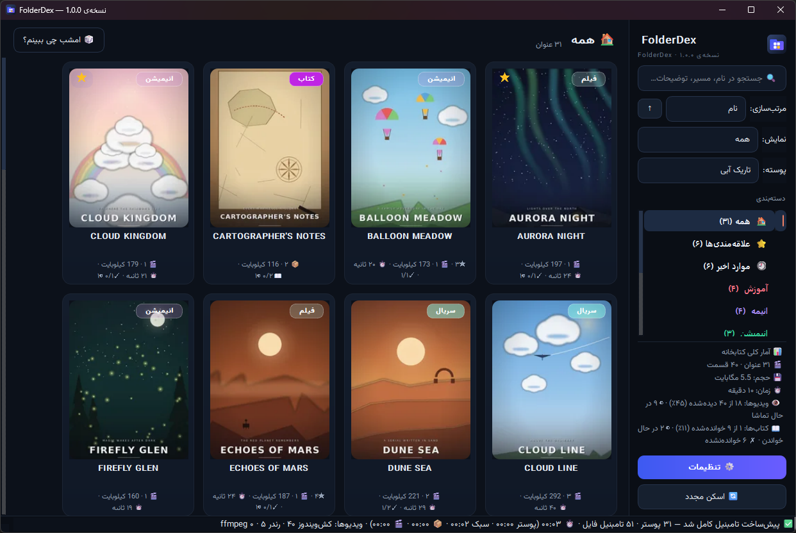
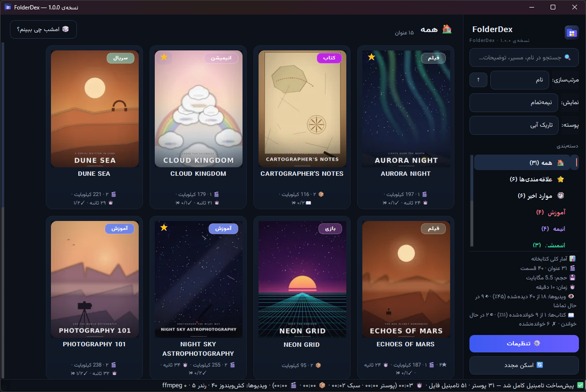
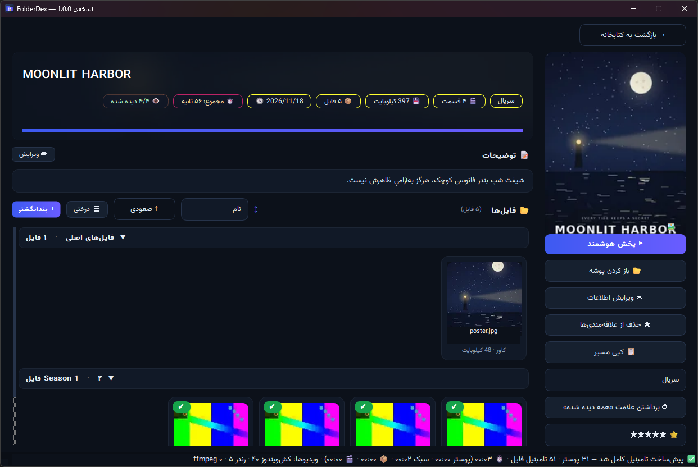
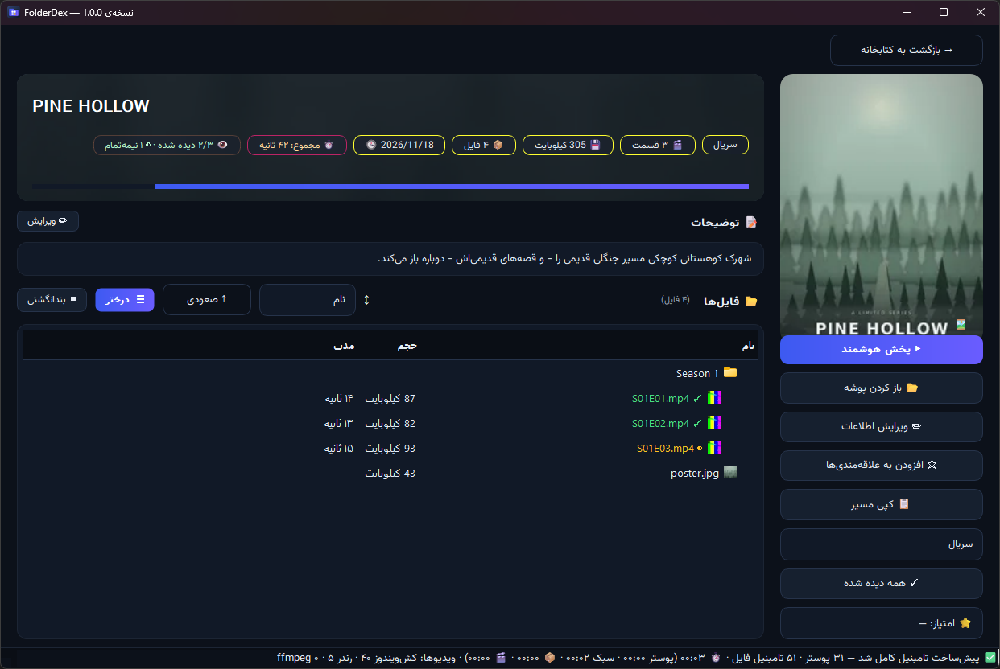
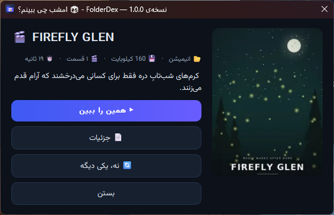
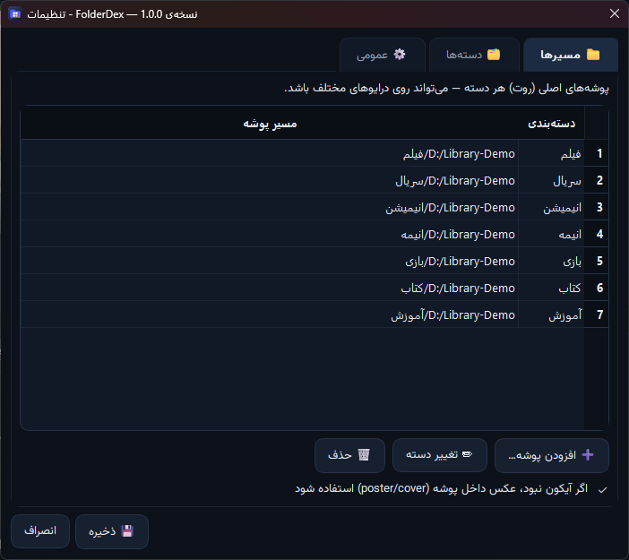
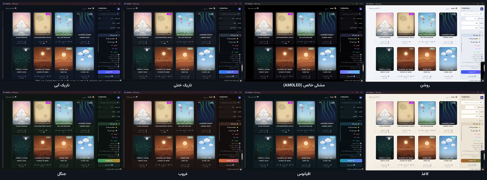

<p align="center"></p>

# FolderDex

**فارسی** | [English](README.md)

**در یک خط:** FolderDex پوشه‌های فیلم، سریال، بازی، کتاب و دوره‌هایتان را
به یک کتابخانه‌ی تصویری و آفلاین برای ویندوز ۱۰ و ۱۱ تبدیل می‌کند — با کاور،
درصدِ پیشرفتِ تماشا و مطالعه، امتیاز و ادامه‌ی پخش از همان‌جا که بودید.
بدون اینترنت در زمانِ اجرا، بدون نصب، و بدون دست‌زدن به فایل‌هایتان.

**برای شما مناسب است اگر** مجموعه‌تان در پوشه‌ها و چند درایو نگهداری می‌شود
و می‌خواهید به‌جای فهرست‌های طولانیِ فایل، آن را با کارت‌های تصویری، درصدِ
پیشرفت و امتیاز مرور کنید. **برای شما مناسب نیست اگر** به‌دنبالِ پخشِ آنلاین، پوسترِ آنلاین یا
پخش‌کننده‌ی داخلی باشید — FolderDex رسانه‌تان را با پخش‌کننده یا
کتاب‌خوانِ خودتان باز می‌کند.

FolderDex یک برنامه‌ی آفلاین و قابل‌حمل برای ویندوز است که مجموعه‌های پوشه و
فایل را در قالب یک کتابخانه‌ی منظم و قابل مرور نشان می‌دهد. برای هر دسته یک پوشه‌ی
اصلی انتخاب می‌کنید؛ هر زیرپوشه‌ی مستقیمِ آن یک عنوان جداگانه در
کتابخانه می‌شود و فایل‌هایی که مستقیماً داخل پوشه‌ی اصلی باشند
هم جداگانه نمایش داده می‌شوند.

وجود کاور سفارشی الزامی نیست. برنامه ابتدا از کاوری که خودتان انتخاب
کرده‌اید استفاده می‌کند؛ در غیر این صورت آیکون ویندوزی پوشه یا
تصاویر داخل آن را نشان می‌دهد و اگر هیچ تصویری نباشد، پیش‌نمایشِ
خودکار (ویدیو، آرشیو، PDF) یا کارتِ ساده‌ی نوع فایل می‌سازد. برای هر
عنوان می‌توان کاور سفارشی انتخاب کرد، آن را تغییر داد یا حذف کرد.
پایگاه داده‌ی SQLite و کاورهای سفارشی و پیش‌نمایش‌ها به‌صورت محلی
ذخیره می‌شوند. برنامه فایل‌ها و پوشه‌های اصلی مجموعه‌ی شما را
تغییر نمی‌دهد.


[](https://github.com/mohammadjafari-dev/FolderDex/actions/workflows/tests.yml)

**ساخته‌شده با هوش مصنوعی:** این پروژه با کمک هوش مصنوعی نوشته شده است.

## اسکرین‌شات‌ها

**کتابخانه با پوسته‌ی تاریک**



**آمار کل کتابخانه**



**فیلتر وضعیت تماشا**



**صفحه‌ی جزئیات**



**پیشرفت تک‌قسمت‌ها**



**«امشب چی ببینم؟»**



**مسیرها و دسته‌ها**



**🎨 هر ۸ پوسته‌ی رنگی**



> اسکرین‌شات‌ها برنامه را با یک کتابخانه‌ی نمونه‌ی اختصاصی نشان می‌دهند؛ همه‌ی پوسترها و کاورها هنرِ نمونه‌ای است که فقط برای همین مجموعه ساخته شده است. نام‌ها و آثار کاملاً ساختگی هستند و به فیلم یا سریال واقعی اشاره‌ای ندارند.

## فهرست مطالب

- [اسکرین‌شات‌ها](#اسکرینشاتها)
- [درباره‌ی برنامه](#دربارهی-برنامه)
- [ویژگی‌ها](#ویژگیها)
- [نصب و اجرا](#نصب-و-اجرا)
- [شروع سریع](#شروع-سریع)
- [تازه‌ها](#تازهها)
- [نقشه‌ی راه](#نقشهی-راه)
- [مستندات](#مستندات)
- [بازخورد](#بازخورد)
- [مجوز](#مجوز)

## درباره‌ی برنامه

برنامه‌ی FolderDex را برای مرتب‌کردن مجموعه‌ی شخصی خودم ساختم؛
مجموعه‌ای شامل فیلم، سریال، انیمه، بازی، دوره‌ی آموزشی، کتاب و کمیک
که سال‌ها در چند درایو نگهداری می‌شد. سپس برنامه را برای انتشار عمومی
آماده کردم.

## ویژگی‌ها

- **کتابخانه‌ی چنددرایوی** — برای هر دسته یک پوشه‌ی اصلی (فیلم، سریال، انیمه، بازی، آموزش، کتاب، کمیک…)؛ فایل‌هایی که مستقیم داخل پوشه‌ی اصلی دسته باشند هم خودکار عنوان می‌شوند
- **نمایش تصویری، نه فهرست فایل** — برای هر عنوان یک تصویر یا کارت ساده نمایش داده می‌شود: کاور سفارشی اگر انتخاب کرده باشید، وگرنه آیکون ویندوزی پوشه، تصویری از داخل پوشه، پیش‌نمایش خودکار یا کارت نوع فایل
- **ثبت وضعیت هر مورد** — برای ویدیو «دیده‌نشده / نیمه‌تمام / کامل دیده‌شده» و برای کتاب، آرشیو، سند، تصویر و مانگای فشرده «خوانده‌نشده / نیمه‌خوانده / خوانده‌شده»؛ امتیاز شخصی ۱ تا ۵ و علاقه‌مندی
- **ادامه‌ی پخش از همان‌جا که بودید** — mpv, PotPlayer و VLC ردیابی می‌شوند (دقیق / واقعی / تخمینی)؛ پخش دقیقاً از جایی که رها کرده بودید از سر گرفته می‌شود
- **مدیریت پوشه‌های جابه‌جاشده یا ناموجود** — بعد از ادغام پشتیبان (یعنی بازیابیِ یک فایلِ پشتیبانِ `‎.mcbak` در کتابخانه‌ی فعلی)، مسیر پوشه‌هایی که به درایو دیگری رفته‌اند خودکار اصلاح می‌شود؛ برای مواردِ ناموجود می‌توانید مسیر تازه تعیین کنید یا آن‌ها را حذف کنید
- **پشتیبان خودکار** — همه‌چیز در یک فایل `‎.mcbak`؛ فقط وقتی چیزی واقعاً عوض شود نوشته می‌شود
- **بازیابی امن** — حالت ادغام ذاتاً غیرمخرب طراحی شده است — پشتیبان را به‌جای جایگزینی، رویِ داده‌های فعلی اعمال می‌کند؛ و پیش از هر جایگزینیِ کامل هم خودکار یک نسخه‌ی پشتیبانِ لحظه‌ای کنار می‌گذارد
- **فهرست موارد اخیر** — ۱۵ موردی که اخیراً باز کرده‌اید، با یک کلیک
- **دوزبانه با ۸ تم** — رابط کاملِ فارسی/انگلیسی، تاریک آبی / تاریک خنثی / مشکی خالص (AMOLED) / روشن / جنگل / غروب / اقیانوس / کاغذ
- **محل نگهداری پیش‌نمایش‌ها کنار برنامه** — پیش‌نمایش ویدیو، آرشیو، PDF و تصویر با قالب WebP (WebP در خودِ Qt رمزگشایی می‌شود — بدون افزونه‌ی جداگانه)؛ فقط فایل‌هایی که عوض شده‌اند دوباره ساخته می‌شوند
- **نمایش روان روی کتابخانه‌های بزرگ** — کارت‌ها پیش از نمایش آماده می‌شوند و حالت‌های عملکرد بر اساس نوع دیسک (SSD یا هارد) تنظیم می‌شوند

➡️ فهرست کامل امکانات: [docs/FEATURES.fa.md](docs/FEATURES.fa.md)

## نصب و اجرا

### بسته‌ی قابل‌حمل (پیشنهادی)

بسته‌ی آماده‌ی
`FolderDex-win64-portable.zip` را از صفحه‌ی
[Releases](https://github.com/mohammadjafari-dev/FolderDex/releases) دانلود کنید؛
سپس آن را در پوشه‌ای **قابل‌نوشتن** (نه Program Files) استخراج کنید و فایل
`FolderDex.exe` را اجرا کنید. هیچ پایتونی لازم نیست و به دسترسیِ مدیرِ سیستم هم نیازی نیست؛ و
برنامه چیزی در رجیستری نمی‌نویسد — برای حذفِ برنامه هم کافی است پوشه‌ی آن
را پاک کنید. نسخه‌های بدون امضای دیجیتال ممکن است یک‌بار SmartScreen نشان
دهند («More info» و بعد «Run anyway»).

> **هشدارِ حذف برنامه — اول خروجی بگیرید!** پایگاه داده‌ی کتابخانه، کاورهای
> سفارشی، کش‌ها و پشتیبانِ خودکار در `backups/` کنارِ برنامه‌اند — با حذفِ
> پوشه‌ی برنامه همه‌ی این‌ها هم حذف می‌شوند. یک استثنا: اگر پوشه‌ی برنامه
> فقط‌خواندنی باشد، کش‌ها به‌طور جایگزین در `%TEMP%\FolderDex-cache` ساخته
> می‌شوند و با حذفِ پوشه‌ی برنامه پاک نمی‌شوند؛ در صورت نیاز آن پوشه را دستی
> پاک کنید. پیش از حذف،
> از طریق *تنظیمات ← عمومی ← خروجی‌گرفتن از اطلاعات (پشتیبان)* از کتابخانه خروجی
> بگیرید و فایل `‎.mcbak` را جای امنی نگه دارید (کنارِ همان پوشه‌هایی که
> رسانه‌هایتان در آن‌هاست).

> **استفاده‌ی آفلاین:** بسته‌ی قابل‌حملِ آماده هیچ اینترنتی نمی‌خواهد — یک‌بار
> دانلودش کنید و کاملاً آفلاین اجرا کنید؛ هیچ داده‌ای هم آنلاین نمی‌فرستد.
> اجرای برنامه از روی کد منبع فقط برای نخستین `pip install` وابستگی‌ها اینترنت
> می‌خواهد؛ اما ساختِ بسته فرق دارد: `BUILD.bat` در هر اجرا یک محیطِ ساختِ
> تمیز از نو می‌سازد و وابستگی‌ها را هر بار از PyPI می‌گیرد (شرح در
> [docs/BUILDING.fa.md](docs/BUILDING.fa.md)).

### اجرای برنامه از روی کد منبع

پیش‌نیاز: پایتون 3.11 تا 3.13 (نسخه‌های جدیدتر را راه‌انداز می‌پذیرد ولی آزمایش نشده‌اند):

```bat
run.bat
debug.bat
diag.bat
```

`run.bat` محیط مجازی پایتون را می‌سازد، پیش‌نیازها را نصب
می‌کند و برنامه را اجرا می‌کند. `debug.bat` هیچ نصبی انجام نمی‌دهد — فقط اگر
محیط مجازی از قبل موجود باشد، برنامه را با پنجره‌ی کنسولِ باز اجرا می‌کند تا
پیام‌های خطا را ببینید. `diag.bat` هم وقتی برنامه اصلاً باز نمی‌شود، وضعیتِ
محیط مجازی و پایتون را جمع می‌کند و در `folderdex-diag.log` برای گزارش باگ می‌نویسد.

> **نکته‌ی پایتون 3.11:** نخستین `pip install` خودکار نسخه‌ی سازگارِ PySide6
> را برای پایتونِ شما انتخاب می‌کند — چیزی برای تنظیم کردن نیست (منطقِ
> انتخابِ نسخه در requirements.txt است).

> **اگر نخستین نصب شکست خورد** (بدون اتصال به PyPI): پیش‌نیازهای اصلی —
> `PySide6` و `Pillow` با کدکِ WebP — برای اجرای برنامه الزامی‌اند؛ بدونِ آن‌ها
> برنامه بالا نمی‌آید و هر بارِ اجرا دوباره برای نصب تلاش می‌کند. فقط وقتی این
> پیش‌نیازهای اصلی نصب‌اند ولی بک‌اندهای آرشیو/PDF نصب نشده‌اند، اجرای بعدی
> برنامه با امکاناتِ کمتر اجرا می‌شود (پیش‌نمایشِ آرشیو و PDF نادیده گرفته
> می‌شود). برای تلاشِ دوباره، فایل نشانگرِ `.requirements_failed` کنار
> اسکریپت را پاک کنید و دوباره اجرا کنید.

### ساخت بسته‌ی قابل‌حمل شخصی

اجرای `BUILD.bat` — جزئیات در
[docs/BUILDING.fa.md](docs/BUILDING.fa.md).

## شروع سریع

1. **پوشه‌ی اصلی هر دسته را انتخاب کنید** — در تنظیمات (دکمه‌ی «⚙ تنظیمات» در
   نوارِ کناریِ برنامه)، برای هر دسته یک پوشه‌ی اصلی معرفی کنید
   (مثلاً `D:/فیلم`، `E:/بازی`). نمونه‌ی پایه‌ی تنظیمات:
   [`config.example.json`](config.example.json) (نام دسته‌ها فارسی) یا
   [`config.example.en.json`](config.example.en.json) (انگلیسی) — تنظیماتِ خودِ
   برنامه کلیدهای بیشتری دارد و خودکار ساخته می‌شود.
2. **ساختار پوشه‌ها** — برای هر عنوان یک پوشه؛ کاور اختیاری است:

   ```
   D:\فیلم\
   └── Some Movie\             ← هر زیرپوشه‌ی مستقیم = یک عنوان
       ├── desktop.ini         ← آیکون پوشه = کاور پیش‌فرض (اگر تنظیم شده باشد)
       ├── icon.ico
       └── فایل‌ها…
   ```

   فایل‌هایی که مستقیم داخل پوشه‌ی اصلی باشند هم خودکار یک «عنوان»
   می‌شوند.
3. **مرور و ردیابی** — صفحه‌ی جزئیاتِ یک عنوان را باز کنید و با `W` دیده‌شده
   علامت بزنید (`W`/`F`/`Space` روی صفحه‌ی جزئیات عمل می‌کنند — `F`
   علاقه‌مندی، `Space` پخش؛ `Alt+←/→` تاریخچه همه‌جا کار می‌کند؛ هیچ‌کدام
   هنگام تایپ در فیلدِ متنی فعال نمی‌شوند)، با ستاره‌ها امتیاز بدهید؛
   همه‌چیز در پایگاه داده‌ی محلی ذخیره می‌شود. پشتیبان‌ها به‌صورت پیش‌فرض در
   پوشه‌ی `backups/` کنار برنامه‌اند؛ مسیرِ مقصد در تنظیمات قابل تغییر است.

## تازه‌ها

**نسخه‌ی 1.0.0** — نخستین انتشار پایدار. FolderDex یک کتابخانه‌ی آفلاین و
قابل‌حمل برای پوشه‌های فیلم، سریال، انیمه، بازی، کتاب و دوره است: کاور و
پیش‌نمایش خودکار برای ویدیو، آرشیو، PDF و تصویر (کشِ WebP کنار برنامه)،
پخشِ mpv و PotPlayer و VLC که دقیقاً از همان‌جا رها کرده بودید از سر گرفته
می‌شود؛ امتیاز و علاقه‌مندی و رنگِ اختصاصیِ دسته‌ها؛ مدیریتِ پوشه‌های
جابه‌جاشده؛ پشتیبانِ خودکار در یک فایل ‎.mcbak با بازیابیِ امنِ ادغامی؛
رابطِ دوزبانه‌ی فارسی/انگلیسی با هشت تم؛ و آمارِ کتابخانه برای هر دسته —
به‌همراهِ ایمن‌سازیِ امنیت و سلامتِ داده در همین نقطه‌ی 1.0.0 (شرح کامل در
[CHANGELOG.fa.md](CHANGELOG.fa.md)).

➡️ جزئیات کامل: [CHANGELOG.fa.md](CHANGELOG.fa.md)

## نقشه‌ی راه

- **بهینه‌سازی عملکرد** — روان‌تر شدن برنامه روی کتابخانه‌های خیلی بزرگ
- **نسخه‌ی لینوکس** — در برنامه‌ی کارِ آینده است و هنوز تاریخ قطعی ندارد؛
  ویندوز ۱۰/۱۱ پلتفرم اصلی می‌ماند

برنامه الان قابل استفاده است؛ این‌ها قدم‌های بعدی‌اند و تاریخ مشخصی ندارند.

## مستندات

- فهرست کامل امکانات: [docs/FEATURES.fa.md](docs/FEATURES.fa.md)
- راهنمای ساخت و بسته‌بندی: [docs/BUILDING.fa.md](docs/BUILDING.fa.md)
- چک‌لیست انتشار (ویژه‌ی نگه‌دارنده): [docs/RELEASING.fa.md](docs/RELEASING.fa.md)
- تغییرات نسخه‌ها: [CHANGELOG.fa.md](CHANGELOG.fa.md) · نسخه‌ی انگلیسی: [CHANGELOG.md](CHANGELOG.md)
- نرم‌افزارهای شخص ثالث همراه برنامه: [THIRD_PARTY_NOTICES.md](THIRD_PARTY_NOTICES.md)
- چطور مشارکت کنم، pull request بفرستم یا باگ گزارش بدهم: [CONTRIBUTING.fa.md](CONTRIBUTING.fa.md)
- گزارش خصوصیِ مشکل امنیتی: [SECURITY.fa.md](SECURITY.fa.md) · نسخه‌ی انگلیسی: [SECURITY.md](SECURITY.md)

## بازخورد

از مشارکت شما استقبال می‌شود — کد، مستندات، ترجمه و تست. اصول پروژه و روشِ ارسالِ
pull request را در [CONTRIBUTING.fa.md](CONTRIBUTING.fa.md) بخوانید. گزارش باگ و پیشنهاد
قابلیت از راه [Issues](https://github.com/mohammadjafari-dev/FolderDex/issues/new/choose) انجام می‌شود — قالب فارسی یا انگلیسی را انتخاب کنید.

## مجوز

منتشرشده تحت [GNU GPL نسخه‌ی ۳ یا جدیدتر](LICENSE) — Copyright (C) 2026 Mohammad Jafari.

نرم‌افزارهای شخص ثالثِ همراه برنامه
(7-Zip و فونت وزیرمتن و آیکون‌های Material Icon Theme و موارد دیگر) مجوز
خودشان را دارند — فهرست کامل در [THIRD_PARTY_NOTICES.md](THIRD_PARTY_NOTICES.md).
