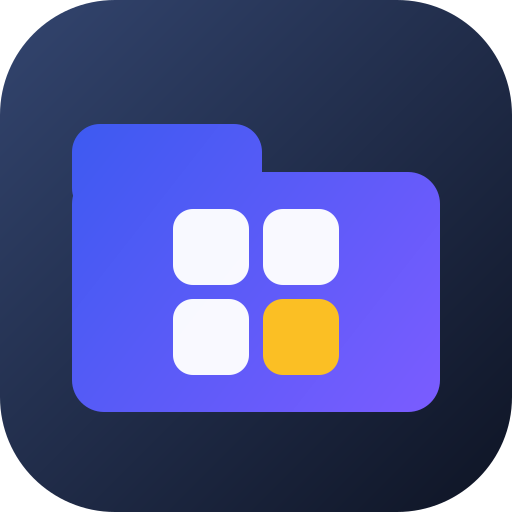
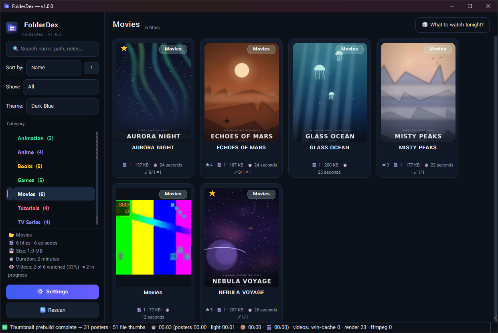
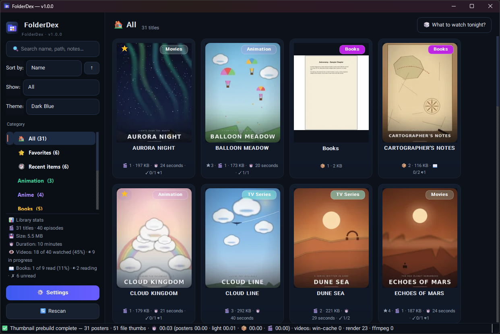
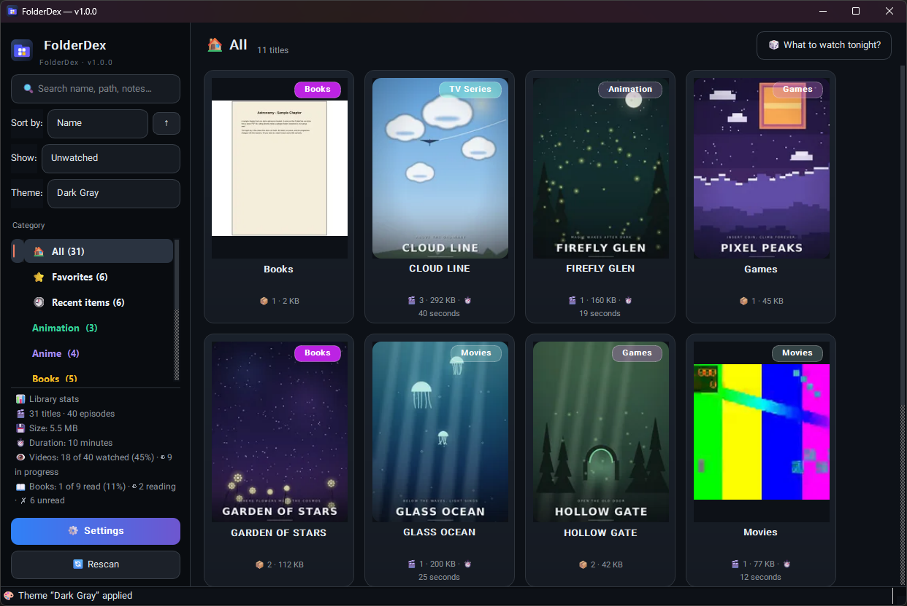
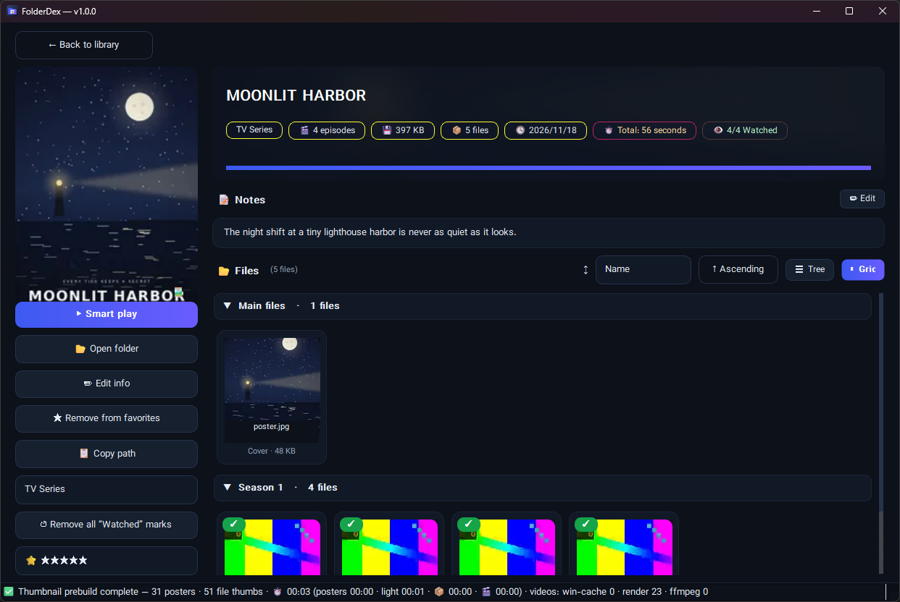
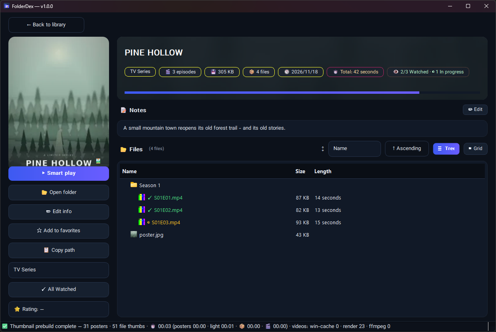
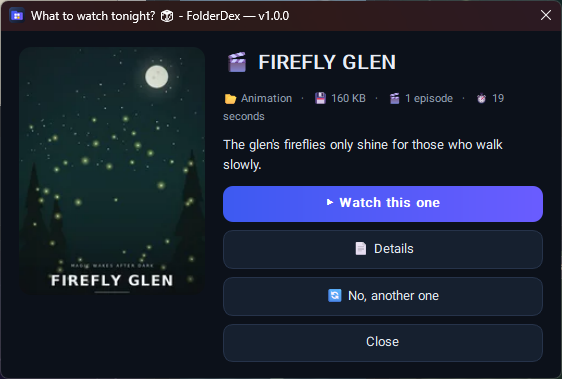
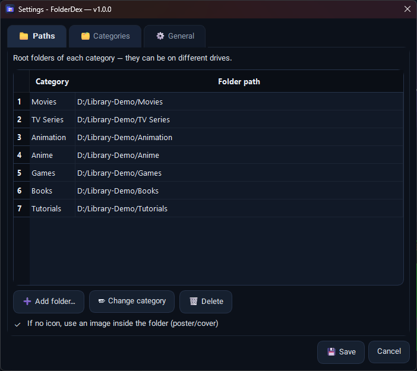
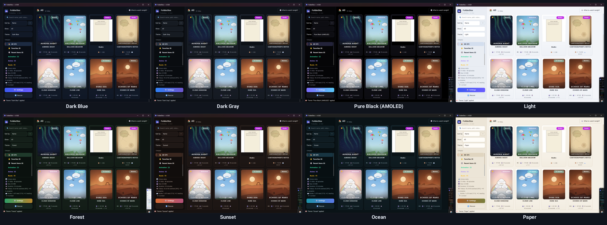

<p align="center"></p>

# FolderDex

**English** | [فارسی](README.fa.md)

**In one line:** FolderDex turns your movie, series, game, book and course
folders into a visual offline library for Windows 10/11 — with covers,
watch/read progress, ratings and resume playback. No internet at run time,
no installer, and your files are never changed.

**A good fit if** your collection lives in folders across drives and you
want to browse it as cards with progress and ratings, not long file lists.
**Not a fit if** you want streaming, online posters or a built-in player —
FolderDex opens your media with your own player or reader.

FolderDex is an offline, portable Windows app for organizing folders and loose
files into a browsable library. Each immediate subfolder under a category root
appears as an independent title; loose files placed directly in a root are
shown as separate entries too.

A custom cover is optional. When available, FolderDex can use the Windows
folder icon or an image inside the folder as the title artwork, and folders
without any image fall back to generated previews (video, PDF, archive) or a
clean file-type card. You can set, replace, or clear a custom cover at any
time. The SQLite database, custom covers, and thumbnails are stored locally.
FolderDex does not modify your original collection files or folders.


[](https://github.com/mohammadjafari-dev/FolderDex/actions/workflows/tests.yml)

**Built with AI:** this project was written with the help of AI.

## Screenshots

**The library — dark theme**



**Library-wide stats**



**Watch-state filter**



**Title details**



**Per-episode progress**



**"What to watch tonight?"**



**Paths and categories**



**🎨 All 8 color themes**



> Screenshots show FolderDex running with an original demo library created for this project — all poster and cover artwork is demo art made exclusively for FolderDex. Titles and artworks are fictional and do not represent real movies or series.

## Table of contents

- [Screenshots](#screenshots)
- [About](#about)
- [Features](#features)
- [Installation](#installation)
- [Quick start](#quick-start)
- [What's new](#whats-new)
- [Roadmap](#roadmap)
- [Documentation](#documentation)
- [Feedback](#feedback)
- [License](#license)

## About

I built FolderDex to organize my own collection — movies, series, anime, games,
courses, books and comics kept across several drives for years — and prepared
it for this public release.

## Features

- **Drive-aware library** — roots per category (movies, series, anime, games, courses, books, comics…), loose files automatically become titles too
- **Visual cards, not a file list** — every title shows an image or a simple card: a custom cover if you set one, otherwise the folder's Windows icon, an image from inside the folder, an auto-generated preview, or a file-type card
- **Watch-state for everything** — Unwatched / In progress / Watched for video; Unread / Partly read / Read for books, archives, documents, images and compressed manga; personal 1–5 star ratings and favorites
- **Player-aware tracking & resume** — mpv, PotPlayer and VLC are tracked (precise / real / estimated); playback continues where you left off
- **Missing-path handling** — after a backup merge (restoring a saved `.mcbak` backup file into your current library), folder paths that moved to another drive are fixed automatically; missing items can be re-pointed or removed
- **Automatic backup** — everything in a single `.mcbak` file, written only when something really changed
- **Safe restore** — merge mode is non-destructive by design — it applies the backup on top of your current data instead of replacing it; before any full replacement, an automatic security snapshot is put aside
- **Recents sidebar** — your last 15 opened titles, one click away
- **Bilingual + 8 themes** — complete English/Persian UI, Dark Blue / Dark Gray / Pure Black (AMOLED) / Light / Forest / Sunset / Ocean / Paper
- **Local thumbnail cache** — video, archive, PDF and image previews cached as WebP (decoded natively by Qt), rebuilt only when needed
- **Smooth display on huge libraries** — cards are prepared before they appear and performance modes adapt to the disk type (SSD or spinning drive)

➡️ Full feature list: [docs/FEATURES.md](docs/FEATURES.md)

## Installation

### Portable package (recommended)

Download the ready-made `FolderDex-win64-portable.zip` from the
[Releases](https://github.com/mohammadjafari-dev/FolderDex/releases) page,
unzip it anywhere **writable** (not Program Files) and run `FolderDex.exe`.
No Python, no admin rights; the app writes nothing to the registry —
uninstall by deleting the folder. Unsigned builds may show a one-time
SmartScreen prompt ("More info" → "Run anyway").

> **Uninstall warning — export first!** The library database, custom covers,
> caches and the automatic backup in `backups/` live beside the application —
> deleting the app folder deletes all of that too. One exception: in a
> read-only application folder the caches fall back to `%TEMP%\FolderDex-cache`
> and survive the deletion — remove that folder manually if needed.
> Before uninstalling or deleting, export the library via *Settings →
> General → "Export data (backup)"* and keep the `.mcbak` file somewhere safe (together
> with the folders you keep your media in).

> **Offline use:** the portable package needs no internet at all — download it
> once and it runs fully offline, and it never sends any data online. Running
> from source needs internet once, for the first `pip install` of the
> dependencies. Building the package is different: `BUILD.bat` recreates a
> clean build environment on every run and re-downloads the dependencies from
> PyPI each time (see [docs/BUILDING.md](docs/BUILDING.md)).

### Run from source

```bat
:: Python 3.11–3.13 (newer versions are accepted by the launcher, but untested)
run.bat        :: creates .venv, installs requirements.txt, launches the GUI
debug.bat      :: runs the app with the console kept open (assumes run.bat
                  already created .venv — it installs nothing itself)
diag.bat       :: when nothing starts: collects venv/Python/import state
                  into folderdex-diag.log for a bug report
```

> **Python 3.11 note:** the first `pip install` automatically picks a
> compatible PySide6 release for your Python version — nothing to configure
> (the version-selection logic lives in requirements.txt).

> **If the first install fails** (no connection to PyPI): the core
> prerequisites — `PySide6` and `Pillow` with the WebP codec — must be
> installed for the app to run at all; without them the launcher keeps
> retrying the install on every start. Only when the core is in place but the
> archive/PDF backends failed does the app start with reduced capabilities
> (archive and PDF thumbnails are skipped). Delete the `.requirements_failed`
> marker file next to the script and run again to retry.

### Build your own portable package

Run `BUILD.bat` — details in
[docs/BUILDING.md](docs/BUILDING.md).

## Quick start

1. **Add your root folders** — in settings (the gear button in the app's
   sidebar), point the app at one folder per category
   (e.g. `D:/Movies`, `E:/Games`). See [`config.example.json`](config.example.json)
   (Persian category names) or [`config.example.en.json`](config.example.en.json)
   (English) for a minimal config example — the app's own `config.json`
   supports more keys and is created automatically.
2. **Folder layout** — one folder per title; covers are optional:

   ```
   D:\Movies\
   └── Some Movie\             ← each immediate subfolder = one title
       ├── desktop.ini         ← folder icon = the default cover (if set)
       ├── icon.ico
       └── files…
   ```

   Loose files directly inside a root automatically become titles of their own.
3. **Browse & track** — open a title's details page and press `W` to mark it
   watched (`W`/`F`/`Space` act on the details page — `F` favorite, `Space`
   play; `Alt+←/→` history works everywhere; none of them fire while typing
   in a text field), rate with the stars, and everything is saved to the
   local database. Backups live in `backups/` next to the app by default;
   the target path is configurable in Settings.

## What's new

**1.0.0** — the first stable release. FolderDex is a portable, offline
library for movie, series, anime, game, book and course folders: covers and
automatic previews for videos, archives, PDFs and images (the WebP cache
lives next to the app), watch/read tracking with resume playback in mpv,
PotPlayer and VLC, ratings, favorites and editable per-category colors, the
missing-path manager, automatic single-file `.mcbak` backups with a safe
merge restore, the bilingual English/Persian interface with eight themes,
and per-category library stats — plus the security and data-safety
hardening of the 1.0.0 milestone (details in [CHANGELOG.md](CHANGELOG.md)).

➡️ Full details: [CHANGELOG.md](CHANGELOG.md)

## Roadmap

- **Performance optimization** — making the app even smoother on very large libraries
- **Linux port** — planned, no date yet; Windows 10/11 stays the primary platform

The app is usable today; these are the next steps and they have no set dates.

## Documentation

- [docs/FEATURES.md](docs/FEATURES.md) — complete feature list
- [docs/BUILDING.md](docs/BUILDING.md) — build & packaging guide
- [docs/RELEASING.md](docs/RELEASING.md) — release checklist (maintainer)
- [CHANGELOG.md](CHANGELOG.md) — release changes · [CHANGELOG.fa.md](CHANGELOG.fa.md)
- [THIRD_PARTY_NOTICES.md](THIRD_PARTY_NOTICES.md) — bundled third-party software
- [CONTRIBUTING.md](CONTRIBUTING.md) — how to contribute, send a pull request, or report a bug
- [SECURITY.md](SECURITY.md) — how to report a vulnerability privately · [SECURITY.fa.md](SECURITY.fa.md) (Persian)

## Feedback

Contributions are welcome — code, documentation, translations and tests. Read
[CONTRIBUTING.md](CONTRIBUTING.md) for the project principles and the pull
request process. Bug reports and feature suggestions go through
[Issues](https://github.com/mohammadjafari-dev/FolderDex/issues/new/choose) — pick the English or Persian template.

## License

Released under the [GNU GPL v3 or later](LICENSE) — Copyright (C) 2026 Mohammad Jafari.

Bundled third-party software (7-Zip, Vazirmatn font, Material Icon Theme icons, …)
keeps its own license — see [THIRD_PARTY_NOTICES.md](THIRD_PARTY_NOTICES.md).
